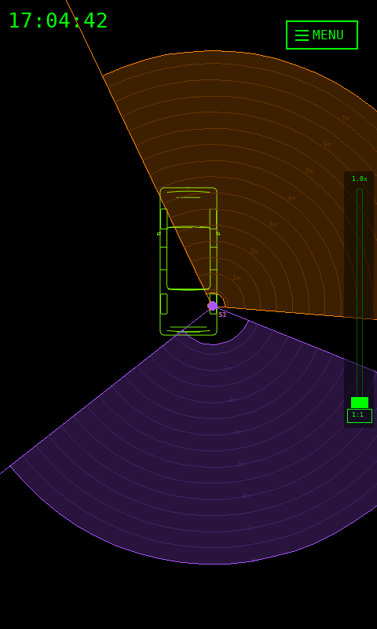
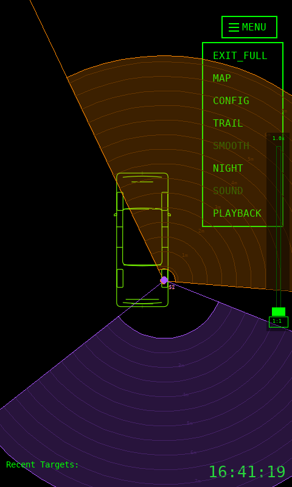

# PondEyes

**PondEyes** is a Python-based visualization tool for real-time tracking of human position and motion using low-cost millimeter-wave radar modules such as the **Hi-Link HLK-LD2450**. It runs on macOS and Linux, using **PyGame** to render a top-down map view of a physical space (e.g., a room or hallway) and displays moving targets based on radar data. The system supports **Serial (UART)** and **MQTT** input, logs all targets to an embedded **SQLite** database, and includes a full playback GUI that replays each recorded session exactly as it was captured.

---

## Overview

PondEyes provides a lightweight, real-time 2D radar visualization layer suitable for research, demonstration, and educational use.  
It is designed around modular components, each in the `radar/` directory, with a launcher (`main.py`) at the project root.

---

## Features

- **Multiple sensors on one shared map** — each with its own pose, input stream, and color
- Per-sensor color (marker, field-of-view cone, and that sensor's targets), with an in-GUI color picker
- **Per-sensor distance gates** (min/max range): hide targets too near/far on the map and
  silence their beep, while the backend still tracks and logs them. Visualized as arcs + a faint
  filled wedge; set them in the Set-Sensor wizard or by **dragging the arcs directly on the map**
- In-GUI sensor management: add / remove / duplicate, click-to-rename, double-click a marker to edit it
- **Map-style navigation** — click-drag or two-finger-scroll to pan, scroll/`+`/`-` to zoom (a pure
  viewport zoom that never alters the geometry), with a zoom slider + `1:1` reset
- **Per-target right-click menu** — **Silence** (mute it from the beep) and **Ghost** (mark a false
  reading: greyed/translucent + silent)
- **Per-sensor data-loss indicator** — a sensor that goes quiet flashes "NO DATA" even while others stream
- Per-sensor trail toggle, with a main-window **master TRAIL override**
- **Per-sensor speed sensitivity** — splits a track when a target "teleports" (the module reused a
  target slot for a different person), while still allowing genuinely fast movement (runners)
- **Editable serial baud** per sensor, with an **AUTO-baud** probe that locks onto the right rate
- Tracks up to three live targets *per sensor* (hardware-limited)
- Custom SVG space maps for accurate placement
- Serial (UART), MQTT, and **simulated** input modes (the `sim` mode needs no hardware)
- Adjustable motion smoothing and trail duration
- Distance-based audible alerts; per-sensor hue, with speed shown by the pulse ring
- Target logging to an embedded **SQLite** database (`pondeyes.db`), with full sensor attribution
  and accurate per-frame timing (timestamped at the reader, not after processing)
- **Faithful playback**: each track is replayed through its *recorded* sensor snapshot — pose,
  color, distance gates, and trail — at the true recorded cadence, so playback looks like the live
  view. The live view and playback share one renderer.
- Verbose runtime logging (`run-logs/pondeyes.log`; `PONDEYES_LOG=DEBUG` for detail)
- **Runs as a Raspberry Pi touchscreen appliance** — fullscreen with a responsive UI that scales to
  small panels (collapsible drop-down menu, touch-sized controls, **Touchscreen Mode**, cursor
  auto-hide) and **auto-launches on boot**. See the **[Raspberry Pi deployment guide](docs/raspberry-pi.md)**.

---


*Two sensors on one map — each with its own pose, color, FOV cone, and distance gates.*

---

## Raspberry Pi touchscreen appliance

PondEyes runs as a self-contained appliance on a Raspberry Pi 4 with a small touchscreen — power it
on and it boots straight into a fullscreen, finger-driven radar view. The interface is
**responsive**: it scales to the panel and switches to a compact, touch-friendly layout on small
screens, so it works across a range of displays.

<p align="center">
  
  &nbsp;&nbsp;
  
</p>

Highlights: an auto-scaling layout, a collapsible **☰ menu**, **Touchscreen Mode** (finger-only,
cursor hidden), an on-screen CONFIG sized for touch, and **boot auto-launch**. Touch is supported
across the common controller types (USB-HID, I²C Goodix/FT5x06, and SPI resistive ADS7846).

**→ Full setup — including different screens and touch controllers — in the
[Raspberry Pi deployment guide](docs/raspberry-pi.md).**

---
PondEyes Development Demonstration (YouTube):
[](https://youtu.be/FxQKXyqbS6g)

---

## Directory Structure

```
PondEyes/
├── main.py                  # Launcher: load config -> RadarGUI -> run
├── radar/
│   ├── config.py            # Loads/saves radar_config.json (schema v2) with migration
│   ├── constants.py         # Global constants, colors, font setup
│   ├── sensors.py           # Sensor dataclass (pose, color, transport, gates, ...)
│   ├── frames.py            # LD2450 wire-format codec (parse / build_frame)
│   ├── reader_base.py       # Reader abstraction + make_reader factory + FakeReader (sim)
│   ├── serial_reader.py     # Serial (UART) reader + AUTO-baud probe
│   ├── mqtt_client.py       # MQTT frame receiver
│   ├── trajectories.py      # Synthetic motion generators (for the sim reader)
│   ├── tracking.py          # Per-target bookkeeping; persists to SQLite
│   ├── store.py             # SQLite TrackStore (sensors / tracks / track_points)
│   ├── geometry.py          # Pure projection + arc math (shared)
│   ├── render.py            # Shared pygame drawing (sensor / target / trail)
│   ├── gui.py               # Live visualization GUI (PyGame main window)
│   ├── playback_gui.py      # SQLite-backed playback GUI (shares the renderer)
│   ├── colors.py            # Color helpers
│   ├── widgets.py           # Small GUI widgets (color picker)
│   ├── svg_utils.py         # SVG rasterization + coordinate fitting
│   ├── sound.py             # Distance/velocity audio tones
│   └── logging_setup.py     # Rotating run-logs/ logger
├── tools/                   # csv_to_sqlite.py (import legacy CSV), sim_sensor.py
├── tests/                   # pytest suite (headless-safe)
├── radar_config.json        # Generated runtime configuration
└── pondeyes.db              # SQLite track log (created on first run; git-ignored)
```

---

## Installation

### Prerequisites

- Python 3.10 or newer  
- PyGame ≥ 2.5  
- CairoSVG  
- Paho-MQTT (if using MQTT mode)  
- pySerial (if using UART/Serial mode)

### Installation Commands

```bash
git clone https://github.com/davidkarnowski/PondEyes.git
cd PondEyes
python3 -m venv .venv
source .venv/bin/activate
pip install -r requirements.txt
```

---

## Hardware: 
The following hardware chains were used in the development of this project:

Direct Serial Connection:
HLK-LD2450 -> FT232 UART to USB Adapter -> MacOS 15 & Ubuntu 24.04 LTS

MQTT Connection:
HLK-LD2450 -> FT232 UART to USB Adapter -> Raspberry Pi Zero -> LAN

### Hi-Link HLK-LD2450 24 Ghz MM-Wave Radar Module

| Specification | Value |
|----------------|-------|
| Frequency Band | 24 GHz ISM |
| Ranging Distance | 6–8 m |
| View Angle | 60° ± Azimuth, 45° ± Elevation |
| Interface | UART (default 256,000 baud) |
| MCU | Internal processing; transmits processed targets |
| Output Format | 30-byte binary frame per update |

This module provides position (X, Y) and velocity data for up to three simultaneous targets.  
It can penetrate non-metallic materials and operate under variable lighting conditions.

Product page: [https://www.hlktech.net/index.php?id=1157](https://www.hlktech.net/index.php?id=1157)

### DSD TECH SH-U09C USB to TTL Serial Adapter with FTDI FT232RL Chip

For direct serial connection testing a UART to USB (TTL) adapter was used and connected to three different systems including an M1 Macbook Pro, Acer Chromebook (running Ubuntu 24.04 LTS) and a Raspberry Pi Zero

Product page: [https://www.amazon.com/dp/B07BBPX8B8](https://www.deshide.com/product-details_SH-U09C.html)

---

## Configuration

Configuration is managed through `radar/config.py` and stored as a JSON file (`radar_config.json`) in the project root. As of v4.0 the schema is **multi-sensor**: a top-level `sensors` array, each entry carrying its own transport, pose, and color. Global display/visual settings stay at the top level.

Example configuration:

```json
{
  "schema_version": 2,
  "sensors": [
    {
      "id": "S1",
      "label": "Front Bumper",
      "color": "#00ff80",
      "input_mode": "serial",
      "serial_port": "/dev/cu.usbserial-0001",
      "serial_baud": 256000,
      "position": [4896.2, 7471.8],
      "heading": 0.0,
      "trail_on": true,
      "min_range_mm": 0.0,
      "max_range_mm": 3000.0,
      "speed_sensitivity": 0.25
    },
    {
      "id": "S2",
      "label": "Rear Bumper",
      "color": "#ff8800",
      "input_mode": "mqtt",
      "broker": "127.0.0.1",
      "port": 1883,
      "topic": "PondEyes/raw_S2",
      "position": [4896.2, 1200.0],
      "heading": 180.0
    }
  ],
  "map": "map.svg",
  "trail_duration": 5.0,
  "trail_on": true,
  "smoothing_on": true,
  "smooth_level": 5
}
```

Per-sensor keys: `serial_baud` (editable in the GUI, with an AUTO-baud probe), `trail_on` (this
sensor's trail, gated by the main TRAIL master button), `min_range_mm` / `max_range_mm` (display
distance gates; `0` = off / unlimited), `speed_sensitivity` (`0` = off … `1` = strict; splits a
track on an implausible "teleport" jump). A `sim` input mode is also available
(`"input_mode": "sim"`, `"sim_pattern": "circle"`) which emits synthetic frames with no hardware.

**Editing sensors:** the in-GUI **CONFIG** screen manages the sensor list (add / remove /
duplicate, click-to-rename, per-sensor transport + baud + color + speed sensitivity). Pose and
distance gates are set on the map — via the **Set-Sensor wizard** (click to place, then a combined
heading + min/max range screen), by **double-clicking a sensor marker** to edit it in place, or by
**dragging a gate arc** directly on the live map.

**Migration:** an older single-sensor `radar_config.json` (schema v1) is migrated automatically
on first launch — its `sensor`/`heading`/transport keys fold into `sensors[0]`, and a one-time
`radar_config.json.bak` is written so you can always revert.

---

## Usage

### 1. Launch Application

```bash
python3 main.py
```

### 2. Select Input Source

- **Serial**: Connect radar via USB/UART.  
  Set `/dev/ttyUSB0` (Linux) or `/dev/tty.usbserial*` (macOS).
- **MQTT**: Enter broker IP, port, and topic (default: `PondEyes/raw`).

### 3. Set Sensor Position and Angle

Using the configuration menu, you can set the sensor location on the map. Click on "Set Sensor" and then "Set Position" buttons allowing you to then use the cursor and click on the map where you've placed the radar module. Once the position is set, the application will allow you to rotate the heading of the module using the slider that appears. Confirm the heading angle and click "Set Heading."

### 3. Configure Motion Trail

The visualized target marker can have a "trail" added via the configuration. Enabling the trail and setting the trail duration will illuminate the marker's trail with the darkest opacity at the current location, fading to transparent, based on the "Trail Duration" setting. Also available is "Target Smoothing" which can be set in 10-steps from Low to High, which will average the data frame position and velocity data against previous frames, helping to reduce jitter in the data output from the module.

### 4. Observe Targets

Targets appear on the SVG map in real-time, color-coded by velocity.  
Trails fade based on `trail_duration`. Audible alerts indicate proximity.

### 4a. Map navigation & controls

The map behaves like a lightweight mapping view — a **pure viewport** transform that never alters
the geometry, only how much of the map you see:

- **Pan** — click-and-drag the map, or two-finger scroll.
- **Zoom** — scroll wheel, the `+` / `-` keys, or the **zoom slider** on the right edge; `0` (or the
  slider's **`1:1`** button) resets to fit. `Ctrl`/`Cmd` + scroll also zooms to the cursor.
  > Note: macOS trackpad **pinch-magnify** is not exposed to pygame/SDL2, so use scroll, `Ctrl`/`Cmd`
  > +scroll, the `+`/`-` keys, or the slider. (A future web frontend would get native pinch.)
- **Per-target right-click menu** — **Silence** mutes one target's proximity beep; **Ghost** marks a
  false reading (greyed/translucent + silent). Toggle either off the same way.
- **Per-sensor "NO DATA"** — a sensor that stops streaming flashes a red indicator on its marker even
  while other sensors keep running (the full-screen banner only fires when *all* sensors go quiet).
- **Top menu** — `SOUND`, `NIGHT`, `SMOOTH`, `TRAIL`, `CONFIG`, `MAP`, `FULL_SCREEN`, `PLAYBACK`.
- **Distance gates** — drag a sensor's min/max arc on the map (a metre readout follows the cursor), or
  set them in the Set-Sensor wizard.
- **CONFIG dialog** — close it with the top-right **✕** or **CANCEL**.

### 5. Logging

All tracks are logged to an embedded **SQLite** database (`pondeyes.db`) in the project root —
one `tracks` row per target with its full **sensor snapshot** (pose, color, distance gates, trail)
and one `track_points` row per frame (`x_mm`, `y_mm`, `range_mm`, `speed_mm_s`, `accel_mm_s2`,
`t_rel_s` high-res relative time, `raw_hex`). The timestamp is captured at the reader (frame
arrival), so the recorded cadence is accurate. (Legacy per-day CSV logs can be imported with
`tools/csv_to_sqlite.py`.) Verbose runtime logs go to `run-logs/pondeyes.log`.

---

## Playback Mode

Open **PLAYBACK** from the main menu to browse recent recordings (newest first) and replay one.
Because each track stores the sensor's recorded snapshot + per-frame timing, playback reconstructs
the scene exactly as it was captured — using the **same renderer** as the live view.

Playback Features:
- Pick a recording from the recent-tracks list
- Replays each track through its **recorded** sensor pose, color, FOV cone, and distance gates
- Accurate timeline driven by the recorded per-frame timing; scrub + speed (1×–20×)
- Toggle trails; a visual HUD with elapsed time

---

## Architecture Summary

- `main.py` — Launches and initializes configuration and GUI.
- `radar/gui.py` — Core live visualization window; rendering, sensor setup, live updates.
- `radar/reader_base.py` — Reader abstraction + `make_reader` factory; `FakeReader` (sim). Readers
  deliver `(frame, t_mono)` so timing is stamped at arrival.
- `radar/serial_reader.py` / `radar/mqtt_client.py` — Serial (with AUTO-baud) and MQTT inputs.
- `radar/tracking.py` — Per-target bookkeeping (incl. teleport split); persists to SQLite.
- `radar/store.py` — SQLite `TrackStore` (versioned schema, per-track sensor snapshot + timing).
- `radar/geometry.py` / `radar/render.py` — Shared projection math + draw primitives used by BOTH
  the live view and playback (one renderer, no duplication).
- `radar/playback_gui.py` — Replays SQLite recordings through the shared renderer.
- `radar/svg_utils.py` — Rasterizes SVGs using CairoSVG for accurate map scaling.
- `radar/sound.py` — Distance/speed-based audible feedback.
- `radar/config.py` / `radar/constants.py` — JSON config (schema v2 + migration) and constants.

---

## Example Workflow

1. Connect radar module via USB or set up MQTT publisher  
2. Launch `python3 main.py`  
3. Use GUI configuration to select mode and confirm connection
4. Observe targets in real time; tracks are logged to `pondeyes.db` automatically
5. Open PLAYBACK to replay or analyze recorded sessions

---

## Development Notes

- PondEyes was designed in an effort to research the effectiveness of mm-wave radar modules for tracking human targets in a private space
- Code modularity allows replacement of radar backends or visualization layers
- `radar/tracking.py` persists tracks to SQLite (`radar/store.py`) with a versioned schema
- The live view and playback share one renderer (`radar/geometry.py` + `radar/render.py`)
- Uses CairoSVG for vector scaling; SVG maps should define physical size (in mm or cm) for accurate projection

---

PondEyes has been analyzed by DeepWiki and the documentation is available for further reference:
[](https://deepwiki.com/davidkarnowski/PondEyes)

---

Copyright © 2025 David D. Karnowski.

---
