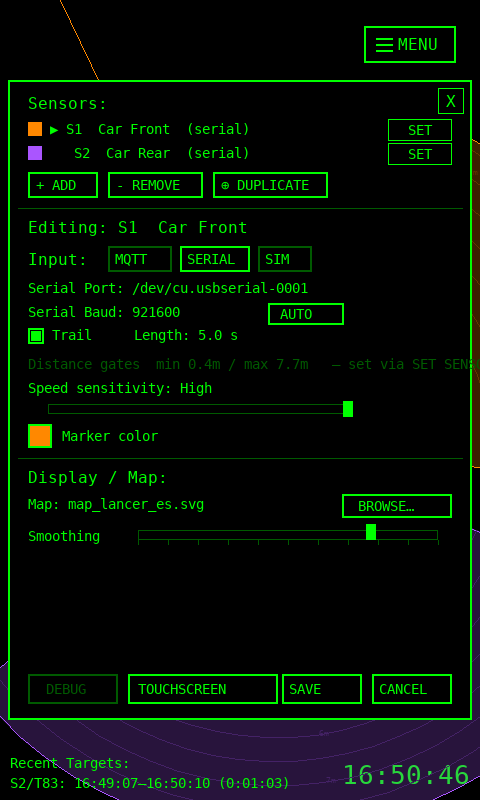

# Running PondEyes on a Raspberry Pi (Touchscreen Appliance)

PondEyes runs well as a self-contained appliance on a Raspberry Pi 4 with a small touchscreen:
power it on and it boots straight into a fullscreen, finger-driven radar view of your space.
The UI is **responsive** — it scales itself to the panel and switches to a compact, touch-friendly
layout on small screens — so it works across a range of displays, not just one specific model.

<p align="center">
  
</p>

This guide covers the full deployment, with notes throughout for the parts that differ between
screens (resolution, orientation, and especially **touch**, which varies the most).

---

## What you get

- Fullscreen radar view on the Pi's own screen (portrait or landscape)
- A **responsive layout** that auto-scales to the display; small panels get a collapsed
  drop-down menu, larger touch fonts, a bottom-anchored target dashboard, and an auto-hiding cursor
- **Touchscreen Mode** — hide the cursor entirely and drive everything by finger
- **Auto-launch on boot** — power on → desktop → PondEyes, no keyboard needed
- Live tracking from the HLK-LD2450 over USB-UART, logged to SQLite, with playback

| | |
|---|---|
|  |  |
| Small-screen drop-down menu | On-screen CONFIG, sized for touch |

---

## 1. Operating system & Python

Use **Raspberry Pi OS 64-bit, Bookworm or newer** (Bookworm = Debian 12 / Python 3.11; Trixie =
Debian 13 / Python 3.13). PondEyes uses Python **3.10+** syntax, so the older Bullseye system
Python (3.9) will not import it — Bookworm or Trixie is required (or install a newer Python via
`pyenv` on an older image).

The **Lite** image is fine to start from — install a desktop in step 4 if your screen needs the
GUI session (most do).

---

## 2. System libraries

PondEyes needs a few native libraries that pip can't provide (Cairo for SVG maps, SDL2 for pygame,
a monospace font, a venv):

```bash
sudo apt update
sudo apt install -y \
    python3-venv python3-dev \
    libcairo2 \
    libsdl2-2.0-0 libsdl2-mixer-2.0-0 libsdl2-image-2.0-0 libsdl2-ttf-2.0-0 \
    fonts-dejavu-core fontconfig
```

> piwheels (preconfigured on Pi OS) provides prebuilt ARM wheels for `pygame`, `cairocffi`, etc.,
> so the pip install in step 3 is fast and doesn't compile from source.

---

## 3. Install PondEyes

```bash
git clone https://github.com/davidkarnowski/PondEyes.git
cd PondEyes
python3 -m venv .venv
.venv/bin/pip install -U pip
.venv/bin/pip install -r requirements.txt

# serial access for the radar — add your user to dialout, then re-login
sudo usermod -aG dialout "$USER"
```

Quick sanity check (no hardware, no display needed):
```bash
SDL_VIDEODRIVER=dummy SDL_AUDIODRIVER=dummy .venv/bin/python -m pytest -q   # expect "passed"
.venv/bin/python main.py --sim                                              # simulated targets
```

---

## 4. Install a desktop (if starting from Lite)

Most touchscreens want the graphical session. On a Lite image:

```bash
sudo apt install -y raspberrypi-ui-mods
sudo raspi-config nonint do_boot_behaviour B4   # boot to desktop with autologin
sudo reboot
```

> If `raspberrypi-ui-mods` fails on a file-conflict (e.g. `pi-greeter-labwc.desktop` "also in
> package pi-greeter"), re-run with `sudo apt-get -o Dpkg::Options::=--force-overwrite install -y
> raspberrypi-ui-mods` — a known packaging conflict, safe to override.

---

## 5. Display: resolution & orientation (varies by screen)

**The PondEyes UI scales to whatever resolution the panel reports** — there's nothing to configure
in the app. Run it fullscreen:

```bash
.venv/bin/python main.py --fullscreen
```

What the app does on a small screen automatically: hides the ASCII logo, collapses the header into a
single **☰ MENU** drop-down, floors the fonts so labels/readouts stay readable, anchors the target
dashboard to the bottom, moves the clock to the top-left, and auto-hides the cursor when idle.

**Native resolution.** Most HDMI panels advertise their mode over EDID and Just Work. If yours
comes up wrong, force it in `/boot/firmware/cmdline.txt` (one line, space-separated):
```
video=HDMI-A-1:800x480@60
```

**Orientation (portrait vs landscape).** Many small panels are *natively portrait* — check the
real mode with `cat /sys/class/drm/card*-HDMI-A-1/modes`. To rotate, pick the layer that matches how
you run PondEyes:

| Where | How to rotate |
|---|---|
| Console / KMS (boot text, and the framebuffer the app uses if run without a compositor) | add `,rotate=90` (or `180`/`270`, clockwise) to the `video=` token in `cmdline.txt`, e.g. `video=HDMI-A-1:480x800@60,rotate=270` |
| Wayland desktop (labwc — Bookworm/Trixie default) | `wlr-randr --output HDMI-A-1 --transform 270`; persist via the **Screen Configuration** tool or a labwc autostart line |
| X11 desktop (LXDE-pi) | `xrandr --output HDMI-A-1 --rotate left`, or the desktop's Screen Configuration |

> Rotation note: a *natively-portrait* panel needs **no** rotation for a portrait UI — it's
> *landscape* use that requires the 90° transform.

---

## 6. Touch input (this is the part that varies most)

The display being visible doesn't mean touch works — touch is a **separate input device**, and the
controller type depends on your panel. Identify yours, then enable it:

```bash
# what input devices does the Pi see?
cat /proc/bus/input/devices | grep -iE "Name=|Handlers="
lsusb                       # USB-HID touch shows up here
```

### a) USB-HID capacitive (most modern HDMI touchscreens)
A separate USB lead (often a micro-USB/USB-C **"Touch"** port on the panel) connects to a Pi USB
port. **Plug-and-play — no driver needed.** It appears in `lsusb` and `/proc/bus/input/devices` as a
multitouch device and works immediately. If touch is dead, it's almost always that USB lead not
being connected to a *data* port. Use a black USB-2 port directly on the Pi.

### b) I²C capacitive (Goodix GT911 / FT5x06 — panels that sit on the GPIO header)
No USB lead; the controller is on the GPIO I²C bus. Enable I²C and load the matching overlay:
```bash
sudo raspi-config nonint do_i2c 0          # enable I2C
sudo apt install -y i2c-tools
```
Add to `/boot/firmware/config.txt` (pins vary by panel — these are the overlay defaults):
```
dtoverlay=goodix,interrupt=4,reset=17
# or, for FT5x06-class panels:
# dtoverlay=edt-ft5x06
```
Note: GT911 controllers often **don't answer `i2cdetect` until the overlay releases their reset
line**, so an empty scan doesn't mean "no chip."

### c) SPI resistive (ADS7846 / XPT2046 — e.g. MPI4008-class 4" panels)
A resistive panel on the GPIO header, driven over SPI. Enable SPI and load the `ads7846` overlay
with your panel's chip-select / pen-IRQ pins (the values below are the common MPI4008 set):
```
dtparam=spi=on
dtoverlay=ads7846,cs=1,penirq=25,penirq_pull=2,speed=50000,keep_vref_on=0,swapxy=0,pmax=255,xohms=150,xmin=200,xmax=3900,ymin=200,ymax=3900
```
Reboot; a new `ADS7846 Touchscreen` device appears in `/proc/bus/input/devices`.

> **⚠️ A word on the `goodtft/LCD-show` scripts.** Many cheap panels ship instructions to run those
> scripts. They were written for old Raspbian and **overwrite `config.txt`/`cmdline.txt` and Xorg
> configs in ways that frequently break boot on Bookworm/Trixie (KMS)** — a real risk on a headless
> box. Take only the **one overlay line** you need from them (as above); don't run the whole script.

### Touch calibration
A natively-oriented panel usually maps correctly out of the box. If touch is offset/mirrored after
a rotation, apply a `libinput` calibration matrix via a udev rule (Wayland) or `xinput`/an Xorg
`99-calibration.conf` (X11). For a 90° CCW display the libinput matrix is `0 1 0 -1 0 1`.

---

## 7. Touchscreen Mode & the cursor

On the live view: open **☰ MENU → CONFIG**, and toggle **TOUCHSCREEN** (next to DEBUG). This hides
the mouse cursor entirely while still accepting taps — ideal for a finger-only appliance. The
setting persists across restarts. Independently, in fullscreen the cursor auto-hides after a few
seconds of no input and reappears on touch.

---

## 8. Audio (the proximity beep)

PondEyes beeps as a target nears. It guards audio init, so it launches fine even with no audio
device. To hear it, route audio (`raspi-config` → System → Audio) to the Pi's 3.5 mm jack, HDMI,
or a USB DAC. The tone is generated with a short fade envelope and a generous mixer buffer so it's
clean (the 3.5 mm jack's analog PWM noise floor is a hardware trait, not the app).

---

## 9. Point PondEyes at your sensor

Edit `radar_config.json` (created on first run). Use the **stable `by-id` serial path** so the
sensor is always found regardless of USB enumeration order:

```bash
ls -l /dev/serial/by-id/      # find your adapter, e.g. usb-FTDI_FT232R_USB_UART_XXXX-if00-port0
```
```json
{
  "sensors": [{
    "id": "S1", "label": "Front", "input_mode": "serial",
    "serial_port": "/dev/serial/by-id/usb-FTDI_FT232R_USB_UART_XXXX-if00-port0",
    "serial_baud": 256000
  }],
  "map": "/home/pi/PondEyes/map.svg"
}
```
The LD2450 runs at 256000 baud by default; the in-app **AUTO-baud** probe can find it if unsure.
(You can also set the sensor pose, color, and distance gates from the on-screen CONFIG + Set-Sensor
wizard.)

---

## 10. Auto-launch on boot (the appliance)

With boot-to-desktop autologin set (step 4), add a desktop **autostart** entry so PondEyes comes up
fullscreen on every boot. A tiny launcher script guarantees the working directory:

```bash
cat > ~/PondEyes/start-pondeyes.sh <<'SH'
#!/bin/bash
cd "$(dirname "$0")"
exec ./.venv/bin/python main.py --fullscreen
SH
chmod +x ~/PondEyes/start-pondeyes.sh

mkdir -p ~/.config/autostart
cat > ~/.config/autostart/pondeyes.desktop <<'DESK'
[Desktop Entry]
Type=Application
Name=PondEyes
Exec=/home/pi/PondEyes/start-pondeyes.sh
X-GNOME-Autostart-enabled=true
DESK
```
Reboot — the Pi should go console → desktop → PondEyes fullscreen on its own. (Adjust `/home/pi`
to your username.) For a hardened appliance, wrap the launcher in a `while true; … done` loop, or
use a systemd user service with `Restart=on-failure`, so it relaunches if it ever exits.

---

## Recommended hardware notes

- **Pi 4 (2 GB+)** is comfortable; the radar load is light, the SVG raster + H.264 (if you record
  the screen) are the only heavy bits, and both are occasional.
- **Boot from a USB SSD** if you can — the per-frame SQLite track log writes continuously, and an SD
  card both wears and is slower; or point the DB at external storage.
- **Screen:** any HDMI (or DSI) touchscreen the Pi can drive works; the UI adapts to its size. The
  fiddliest variable is the **touch controller** (§6) — prefer a USB-HID capacitive panel for the
  least setup.

---

## Troubleshooting

| Symptom | Likely cause / fix |
|---|---|
| App crashes at launch with "No available audio device" | Older build, or no audio configured — current PondEyes guards this; otherwise set `SDL_AUDIODRIVER=dummy` |
| Screen shows "no signal" after a reboot | Often just the boot blackout; if persistent, add `hdmi_force_hotplug=1` or an explicit `video=` mode |
| Display works but **no touch** | Touch is a separate device — see §6. Check `lsusb` / `/proc/bus/input/devices`; for GPIO panels you need the right overlay |
| Touch is offset / axes swapped | Calibration after rotation — apply a libinput matrix (§6) |
| Menu/dialog text tiny | Make sure you're on a current build (responsive scaling) and running `--fullscreen` |
| Won't import / `TypeError` on startup | Python too old (Bullseye 3.9) — use Bookworm/Trixie or a newer Python (§1) |

---

For a deeper technical writeup of the bring-up (the LD2450 ESP32/FTDI serial bridge, etc.), see
`../firmware/README.md`.
